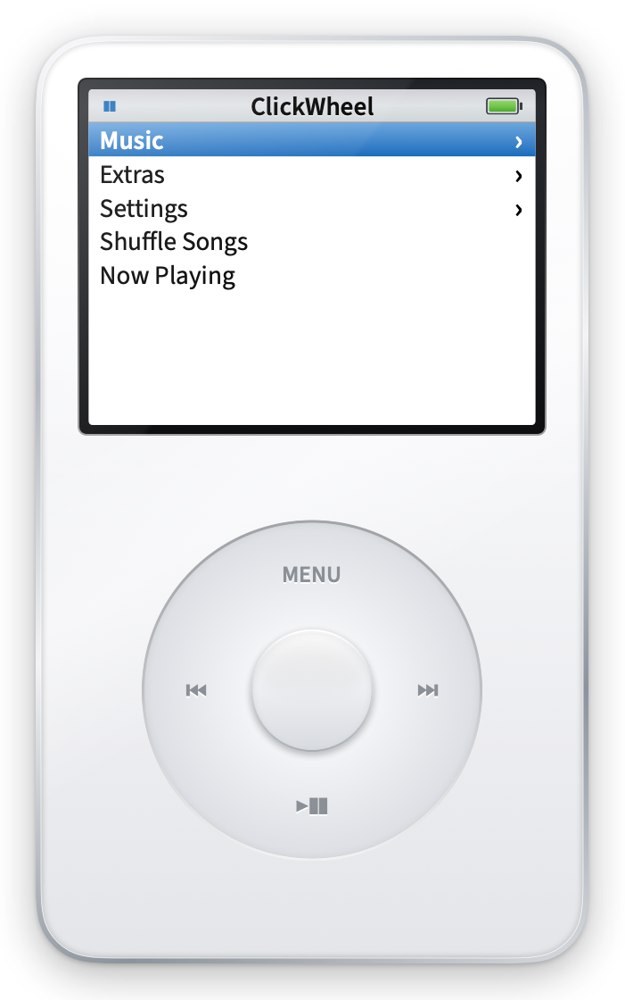

# ClickWheel

A tiny floating click-wheel music player for your Mac. It doesn't play music
itself: it's a remote for **Apple Music** and **Spotify**, and it follows
whichever one is playing.



> A fan homage to classic click-wheel music players. Not affiliated with or
> endorsed by Apple. All artwork is drawn in code; no Apple software, fonts,
> icons or sounds are included.

## Features

- **Life size**: drawn to Apple's dimensional drawing of the iPod (5th generation),
  scaled to your display's real density, so it measures 61.8 × 103.5 mm on screen.
- **The 5G colour screen**: gradient title bar, white 9-row menus with the blue
  selection bar, marquee for long names, and slide transitions.
- **Now Playing**: "x of y", album art, title / artist / album and the glossy
  progress bar. Turn the wheel for the volume bar. Press Center for the
  scrubber (◆), then turn to seek.
- **Click wheel**:
  - Drag in a circle to scroll, with gentle acceleration when you spin fast and
    Quick Scroll letters in long lists.
  - Tap the buttons: MENU (back), ⏮ (restart, or previous track), ⏭ (next),
    ▶❚❚ (play/pause), center (select).
  - Hold them: hold MENU to jump to the main menu; hold ⏭ or ⏮ to fast-forward
    or rewind.
  - A 1 kHz clicker ticks as you scroll.
- **Keyboard**: ↑ ↓ scroll; ← ⏮, → ⏭, Return center, Esc MENU, Space ▶❚❚
  (holds work too).
- **Main menu**: Music, Extras (Clock, Stopwatch), Settings, Shuffle Songs, and
  Now Playing while something plays.
- **Music** (Apple Music library): Playlists, Artists, Albums and Songs. Picking a
  song plays it in context: the rest of the playlist, album or song list follows.
- **Settings**: source (Auto / Apple Music / Spotify), clicker on/off.
- Borderless floating window: drag it anywhere; right-click for **Keep on Top** or **Quit**.

Albums, artists, Songs and Shuffle Songs play through a playlist named
**ClickWheel**, which ClickWheel creates in your Music library and refills each
time. It syncs to your other devices with the rest of your library. Opening a
Music list launches Music if it isn't running.

## Build

Requires macOS 14+, Xcode and [XcodeGen](https://github.com/yonaskolb/XcodeGen).

```bash
brew install xcodegen
xcodegen generate
open ClickWheel.xcodeproj   # then Run
```

Run the tests with `./scripts/test.sh`.

The first time ClickWheel talks to Music or Spotify, macOS asks for permission
to control it. Click **Allow**. You can change this later in
System Settings → Privacy & Security → Automation.

## Roadmap

1. ✅ Now Playing and transport controls
2. ✅ Apple Music library menus (Playlists, Artists, Albums, Songs)
3. Spotify library menus (via the Spotify Web API)
4. Extras: alternate skins, more settings

## Credits

- [Source Sans 3](https://github.com/adobe-fonts/source-sans) by Adobe, under the
  SIL Open Font License (see `ClickWheel/Resources/Fonts/OFL.txt`).
- Screen layout and colour values are modified/derived from the **iVideo** theme
  for iPod Video (CC-BY-SA 3.0) by Humberto Santana; see
  `docs/reference/ipod-5g-screen-values.md`.
- MIT licensed. See [LICENSE](LICENSE).
